# Secure EHR Insight & Clinical Validator (Gen-AI) — Cleaned Notes

Cleaned, organized version of `monal-handwritten-notes.pdf` (9 handwritten pages).  
Anything marked **(?)** was hard to read in the handwriting.

---

## Contents

1. [The big picture](#1-the-big-picture)
2. [AI-SDLC: how we build it](#2-ai-sdlc-how-we-build-it)
3. [Full system overview](#3-full-system-overview)
4. [Phase 0 — Database on AWS EC2](#4-phase-0--database-on-aws-ec2)
5. [Phase 1 — pgvector + embedding column](#5-phase-1--pgvector--embedding-column)
6. [Phase 2 — Fill the embeddings](#6-phase-2--fill-the-embeddings)
7. [Redaction with Microsoft Presidio](#7-redaction-with-microsoft-presidio)
8. [Guardrails + LLM](#8-guardrails--llm)
9. [API endpoints](#9-api-endpoints)
10. [Streamlit chat UI](#10-streamlit-chat-ui)
11. [Agent with LangGraph + chat history](#11-agent-with-langgraph--chat-history)
12. [One-page summary](#12-one-page-summary)

---

## 1. The big picture

### Prerequisites

`Python` · `Database (SQL)` · `RAG` · `OOP` · `LLMs` · `Workflows` · `Agents`

### What hospitals have

Hospitals store patient records in an **EHR** (Electronic Health Record).

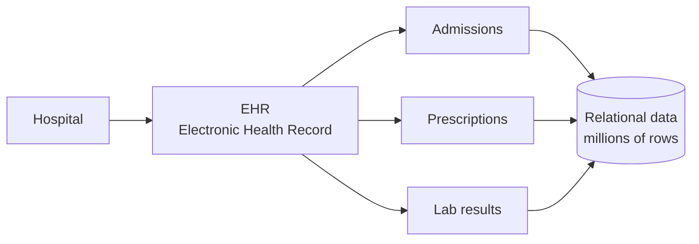

### Problem statement

> Let doctors ask questions about patient histories **in plain English** (natural language), using an LLM, **to save time**.

### Why we can't just plug data into an LLM

The obvious tools exist: **RAG**, **Text-to-SQL**, **Vector DB**. But sending data **directly** to an LLM is wrong ❌.

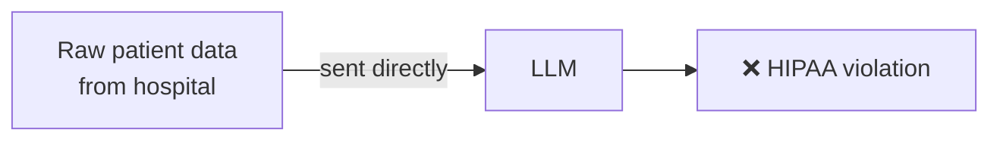

**HIPAA** = US law protecting patient health information. Raw names, IDs, card numbers, etc. must never leak to an outside LLM.

### The solution

| Piece | What it means |
|---|---|
| **Privacy-first pipeline** | Data is cleaned *before* it ever reaches the LLM |
| **Guardrails** | Rules that block unsafe questions / answers |
| **Personal data protection** | Personal details are found and masked (redaction) |

---

## 2. AI-SDLC: how we build it

**SDLC** = Software Development Life Cycle.

### Traditional SDLC

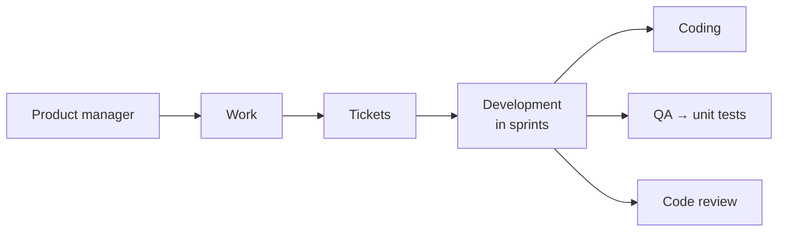

### AI-SDLC = "vibe coding on steroids"

Same steps, but AI helps at every stage, guided by planning files.

| Stage | What happens |
|---|---|
| **Developer plans** | Write a plan, `steps.md`, tasks, and edge cases |
| **Boilerplate** | `plan.md` → project structure + system design → AI executes it |
| **Testing** | AI writes unit tests / test cases and a report → **human reviews** |
| **Pull requests** | AI reviews PRs for **secrets (security flaws)** and **performance regressions** |
| **Maintenance / update** | Hotfixes + keep the docs updated |

> Key idea: AI does the typing, **you** own the plan and the review.

---

## 3. Full system overview

This is the whole app end to end. The numbered phases below build it piece by piece.

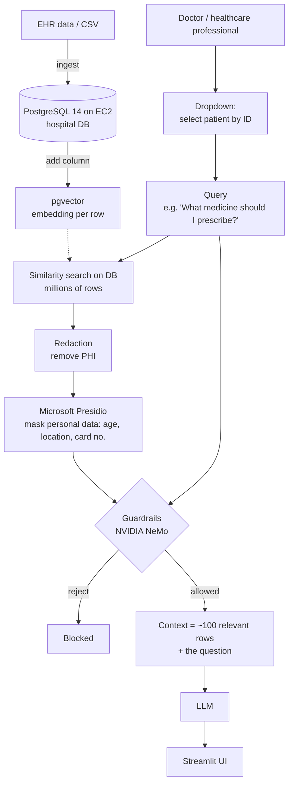

**PHI** = Protected Health Information.

### Redaction example

| Before | After |
|---|---|
| `My credit card info is: 345...` | `My credit card info is: <card-no>` |

### Two jobs, two tools

| Concern | Tool |
|---|---|
| **Redaction** (hide personal data) | Microsoft **Presidio** |
| **Guardrails** (block unsafe use) | NVIDIA **NeMo Guardrails** |

Both together = **HIPAA protection**.

---

## 4. Phase 0 — Database on AWS EC2

### Create things in this order

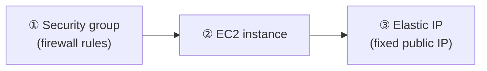

### EC2 settings

- **4 GB** RAM
- **20 GB** storage
- Launch instance → **install PostgreSQL** → **configure PostgreSQL** (allow remote connections)

### Load data from your laptop

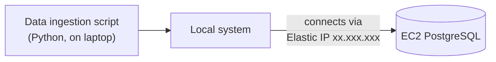

The ingestion script does three things:

1. Creates the **schema**
2. Loads the **CSV → EC2 database**
3. **Tests** that rows arrived

### Python environment with `uv`

| Command | Effect |
|---|---|
| `uv` alone | installs into the **global** environment |
| `uv venv` | creates an **env inside the project folder** ✅ preferred |

**Result of Phase 0:** data is ingested into EC2.

---

## 5. Phase 1 — pgvector + embedding column

- Install the **pgvector** extension on the database.
- An embedding model turns text into a **vector** (a list of numbers).
- Add a new column to store those vectors.

```text
Table: patient_encounters
┌──────────────────────────┬────────────────────────────────┐
│ existing patient columns │ clinical_embedding vector(768) │
└──────────────────────────┴────────────────────────────────┘
```

`768` = the number of values each embedding has. It must match the model's output size.

---

## 6. Phase 2 — Fill the embeddings

### Picking the embedder

A general model like **MiniLM** was questioned **(?)**. Healthcare text is full of **medicines, drugs, and diseases**, so we need a **clinical** embedding model.

### How each row gets its vector

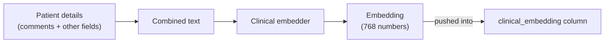

```text
Before:  clinical_embedding = NULL
After:   clinical_embedding = [0.12, -0.03, ... 768 values]   ← not NULL anymore
```

⏱ Pushing embeddings **takes time**. Example from class: **~11,000 rows in ~20 minutes** on EC2. That database was then selected in `.env`.

### Recap of everything so far

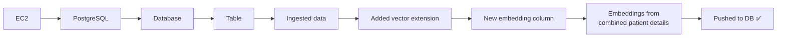

### How search works

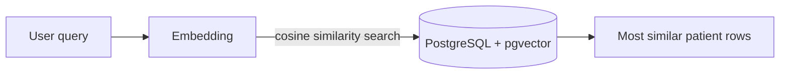

**Cosine similarity** = how close two vectors point in the same direction. Closer = more similar meaning.

---

## 7. Redaction with Microsoft Presidio

### Where redaction sits

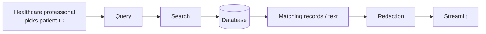

### Building blocks

| Part | Role |
|---|---|
| **spaCy** + English language model | Understands the text (finds names, places, etc.) |
| **Microsoft Presidio** | Uses spaCy to detect and mask personal data → works fine |
| `AnalyzerEngine()` | **Finds** sensitive entities in the text |
| `AnonymizerEngine()` | **Replaces** them (masking) |

```python
self.analyzer = AnalyzerEngine()      # detects: PERSON, ORGANIZATION, NUMBER, EMAIL ...
self.anonymizer = AnonymizerEngine()  # masks what the analyzer found
```

The list of entities to detect can be chosen. In class, some (like PERSON and EMAIL) were toggled on/off.

A small test script shows input vs masked output, e.g. a sensitive value becomes `XX` **(?)**.

### Country-specific IDs

Each region has its own ID number, so you add a recognizer per country:

| Region | ID type |
|---|---|
| India (IND) | Aadhaar |
| US | SSN |
| Canada (CA) | — (add as needed) |
| EU | — (add as needed) |

### How the analyzer decides: confidence scores

Every word gets a **score** for "is this sensitive?".

```text
"Hello, how are you   SSN: 111-22-3333,  my name is John"
  0.1    0.2  0.1 0.2       0.9 → SSN       0.1 0.1 0.1  ~0.7 → PERSON
```

Rule: **redact if score > 0.45** (the threshold).  
Normal words score low and stay. The SSN and the name score high and get masked.

---

## 8. Guardrails + LLM

### Guardrails (next phase)

- NeMo Guardrails rules are written in **`.co` files** (Colang) → you **create flows** in them.
- The LLM call then either:

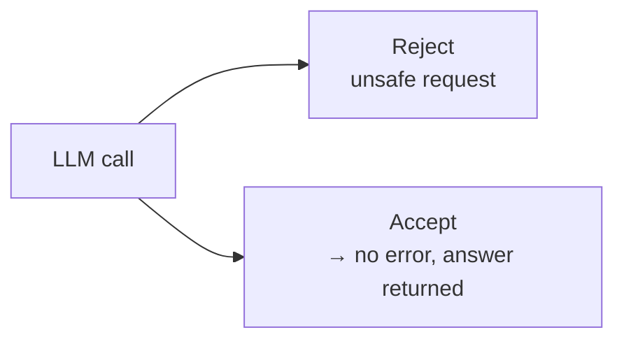

### Which LLM?

**DeepSeek API** → cheap and powerful.

### Complete request flow

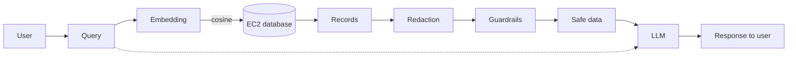

The LLM receives **the original question + the safe, redacted data** together.

---

## 9. API endpoints

File: `api.py`

| Endpoint | Purpose |
|---|---|
| **api-1** (trial API) | Test: send a query → get a response |
| **api-2** `chat` | Query → DB → get records → etc. (the real chat flow) |
| **api-3** `patients` | Get all patient IDs (for the dropdown) |

---

## 10. Streamlit chat UI

```text
┌──────────────────────────────────────────┐
│ [▼ Patient ID]  ← populated from api-3   │
│                                          │
│  user: message                           │
│  bot:  message                           │
│                                          │
│ [ type your question.............. ]     │
└──────────────────────────────────────────┘
```

What happens to a user message:

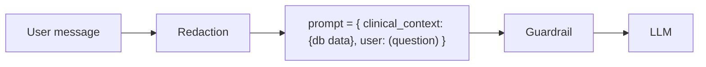

The chat window keeps showing messages one after another, newest at the bottom.

---

## 11. Agent with LangGraph + chat history

### ReAct agent

**LangGraph** → build an **Agent** → for a simple task use a **ReAct agent**.

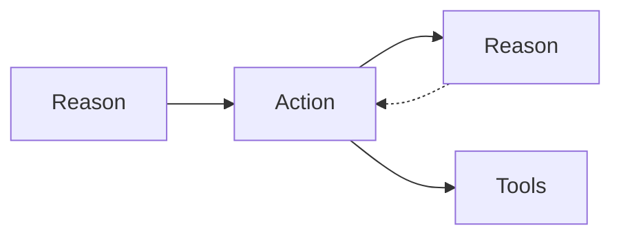

**ReAct** = **Re**ason + **Act**: think → use a tool → think again → until done.

### Conversation history

The LLM has no memory. You send the **whole history** on every API call.

```python
chat = []  # starts empty

chat.append({"role": "user", "content": "Hello"})
# ... agent replies ...
chat.append({"role": "agent", "content": "<response>"})

# every LLM API call sends the full `chat` list
```

```text
call 1:  [user: Hello]
call 2:  [user: Hello, agent: Hi, user: next question]
call 3:  [ ...everything so far... ]   ← list keeps growing
```

---

## 12. One-page summary

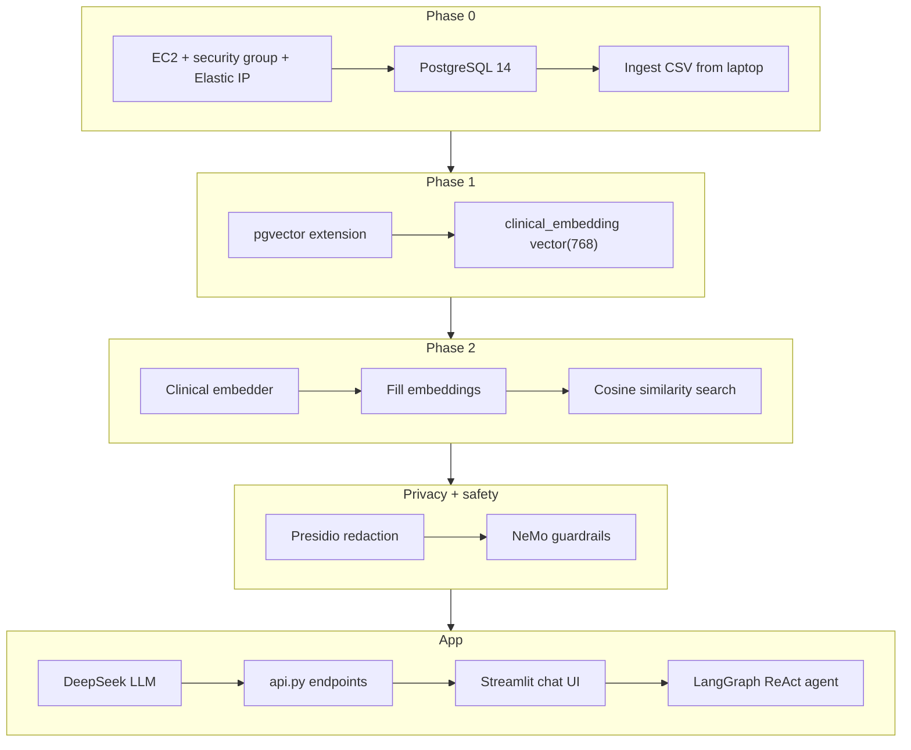

| Term | Meaning in one line |
|---|---|
| EHR | Digital patient record held by a hospital |
| HIPAA | US law: protect patient health info |
| PHI | Protected Health Information (names, IDs, card numbers…) |
| Embedding | Text converted into numbers that capture meaning |
| pgvector | PostgreSQL extension to store and search embeddings |
| Cosine similarity | How alike two embeddings are |
| Redaction | Finding and masking personal data |
| Guardrails | Rules that block unsafe questions or answers |
| ReAct agent | LLM loop: reason → act with a tool → reason |
